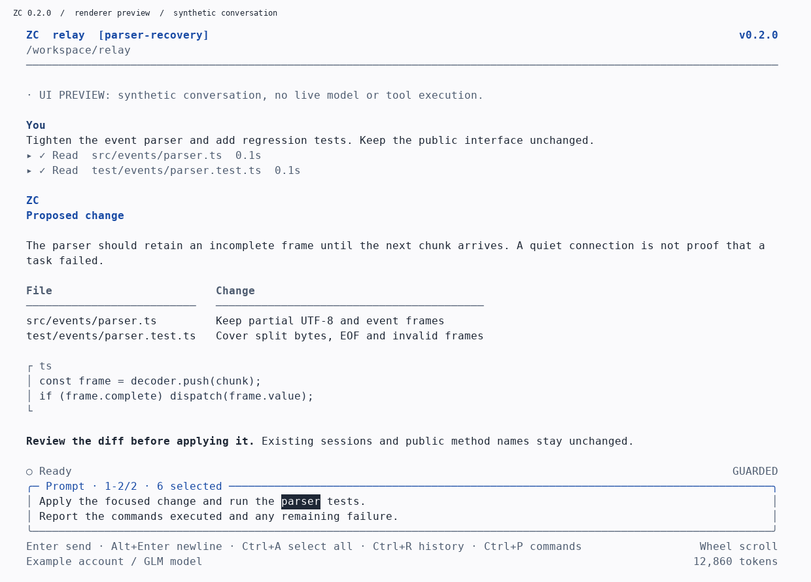

# ZC Workbench

**Your project. One terminal. One command.**

ZC is an independent terminal coding workspace by **Striking Lions**. It installs a pinned ZCode client as its runtime dependency and presents a separate editor, conversation view, tool activity, session browser, and permission controls.

**0.2.0 integration preview.** This release changes the editor, long-turn monitoring, transcript storage, and installation layout. Local tests and a real POSIX terminal exercise use synthetic runtimes, not live Z.ai credentials. Read [what was actually tested](docs/VALIDATION.md) before distributing this as a stable release. There is no affiliation with Z.ai, Apple, Anthropic, or OpenAI.



*The preview is generated from the real renderer. Its task and tool results are synthetic, not evidence of live inference.*

## Install from this repository

Requires Git and Node.js **24.14 or newer**. This source is
`@striking-lions/zc` 0.2.0 with the `zc` command, not the older
`zai-workbench-cli` 0.2.1 package with the `zai` command. The older code remains
in Git history after the migration is merged.

**macOS, Linux, and WSL:**

```bash
git clone https://github.com/Misbah-Engr/zai-cli.git
cd zai-cli
npm install --global .
zc
```

**Windows PowerShell:**

```powershell
git clone https://github.com/Misbah-Engr/zai-cli.git
Set-Location zai-cli
npm.cmd install --global .
zc.cmd
```

These main-branch commands apply after the ZC migration is merged. While reviewing
a pull request, use its branch instead. npm installs the pinned coding runtime
as a dependency. A separately installed `zcode` command is not required. Use
`zc login` for account authorization. An existing external-runtime override can
be replaced with `zc config managed`.

For a user-owned managed installation from this checkout:

```bash
npm pack
bash install/install.sh --package "$PWD/striking-lions-zc-0.2.0.tgz" --add-path
```

PowerShell equivalent:

```powershell
npm.cmd pack
powershell -NoProfile -ExecutionPolicy Bypass -File .\install\install.ps1 -Package "$PWD\striking-lions-zc-0.2.0.tgz" -AddPath
```

Both managed installers acquire an isolated Node engine and the runtime
dependencies. They are not offline binary installers. No npm registry
publication of `@striking-lions/zc` is claimed.

## Install once

### Recommended: the supplied installation bundle

Extract `zc-0.2.0-install.zip`. It contains the npm package, two inspectable installers, and checksums. Close an existing ZC process intentionally before upgrading; exiting an active session can cancel its current task.

**macOS, Linux, and WSL:**

```bash
bash install.sh --add-path
```

**Windows PowerShell:**

```powershell
powershell -NoProfile -ExecutionPolicy Bypass -File .\install.ps1 -AddPath
```

The PowerShell policy override applies to that installer process, not the machine policy. Review the script before executing it. Native Windows execution of this installer has not been tested in the current build environment.

The installers acquire an isolated **Node.js 24.22.0** from the official Node distribution, verify its archive against the HTTPS checksum manifest, and install ZC plus **zcode-app-cli 3.15.3-37**. First installation needs internet access to Node and npm. The small installation ZIP does not contain the Node binaries or an offline copy of all dependencies. Checksums are not a code-signing certificate.

They do not replace system Node, require administrator privileges, or delete upstream credentials. They use a user-owned, versioned installation directory and retain the previous launcher and ZC preferences. The installer selects the managed native backend in guarded launch mode. A prior theme preference is retained. It does not retain YOLO as a global default.

Open a new terminal after installation:

```bash
cd /path/to/your/project
zc
```

No `npx`, separate `zcode` setup command, runtime path, or authentication environment variable is needed for normal launches. On a fresh account, connect once with:

```bash
zc login
```

On an SSH server, `zc login` prints an authorization URL for your local browser. Existing account entitlement is still required. The runtime handles authentication; ZC does not turn a subscription into unlimited model access.

### Existing Node installation

With Node.js **24.14 or newer**, the ordinary npm package is also supported:

```bash
npm install --global ./striking-lions-zc-0.2.0.tgz
zc
```

Use `npm.cmd` and `zc.cmd` in PowerShell when npm's script shims encounter execution-policy restrictions. This command installs the runtime dependency automatically. It does not install a Node engine. For an upgrade from a preview configured with an external runtime, `zc config managed` selects the integrated backend.

This package has not been published to the npm registry as part of this delivery. Do not install a similarly named registry package. The dependency on `zcode-app-cli` is pinned; its transitive dependencies follow that package's dependency ranges. Each installer release retains the lockfile npm actually resolved. A fully locked offline dependency bundle has not been produced here.

## Start working

```bash
zc                         # Open the current project
zc /path/to/project        # Open another project
zc resume                  # Resume this project's last recorded conversation
zc --resume SESSION_ID     # Resume an exact session
zc demo                    # Offline interface preview
zc doctor                  # Local installation checks, not a live model test
```

On the first upgrade from 0.1.x, `zc resume` opens the project session picker when there is no new-style last-session record. No old prompt is automatically sent. A blank session opened and closed without a task does not replace the last meaningful conversation.

Choose an available model with `/model`. The picker uses runtime-advertised IDs rather than invented provider names. ZC remembers the model from a used conversation for the next project session when that exact model remains available.

Give the agent a concrete task, such as:

```text
Inspect the parser and its tests. Implement bounded buffering for incomplete frames,
keep the public interface unchanged, and run the relevant tests. Report the actual
commands and results, then summarize the diff.
```

The launch policy is **guarded**, not a promise to ask before every command. To request full access for the current native session:

```text
/mode yolo
```

Review the confirmation, select **Enable YOLO**, then press Enter. The **YOLO / FULL ACCESS** label appears after runtime acknowledgment. `/mode ask` returns to guarded policy. Neither command resubmits a task. Mandatory upstream confirmations and planning restrictions can still apply. See [full access](docs/FULL-ACCESS.md).

## Editing that behaves like an editor

| Interaction | Result |
| --- | --- |
| Click inside the prompt | Position the caret |
| Drag inside the prompt | Select a text range |
| Double-click a prompt word | Select the word |
| Shift + arrows, Home, End | Extend a selection |
| Ctrl+A | Select the entire draft |
| Backspace, Delete, or typing | Remove or replace the selected range |
| Ctrl+Z / Ctrl+Y | Undo / redo |
| Alt+Enter or Ctrl+J | Insert a newline |
| Enter | Send, only when not blocked by a dialog or active task |
| Up / Down | Move through prompt lines; never recall history |
| Ctrl+R or Alt+Up / Alt+Down | Explicit prompt history |
| Ctrl+C on a selection | Request terminal clipboard copy |
| Ctrl+X on an editor selection | Cut the selected range |

Bracketed paste does not submit a task or approve an action. The prompt accepts up to 64,000 characters. Undo is bounded to 100 snapshots and a two-million-character budget. Existing sensitive values are redacted when drafts are saved; the active editor shows the text you are editing.

Clipboard transfer uses OSC 52 on an explicit copy/cut gesture. Support depends on your terminal and SSH/tmux configuration. ZC does not silently change the terminal's clipboard permissions. Use `/mouse off` and the terminal's native selection, or `/export`, when clipboard transfer is unavailable.

## Read the entire retained conversation

The mouse wheel and Page Up/Page Down scroll the conversation, not the prompt history. Click transcript text to focus it, then use arrows to move through the view. Press Enter to focus the editor again. Ctrl+Home jumps to the oldest archived entry; Ctrl+End returns to live output. New events do not forcibly pull a scrolled view back to the bottom.

Use **Ctrl+F** or `/search words` to search the visible transcript archive. Search returns up to 100 matches. Click a tool row to expand its output; Ctrl+O expands or collapses all currently displayed tool details.

ZC 0.2.0 adds an append-only local transcript with paged, byte-bounded history windows. The current screen still uses a bounded working set, but older archived entries are accessible instead of being silently discarded. `/export` includes the archive, not only the current screen.

This is a **visible transcript**, not a raw protocol recording. Assistant messages are bounded to 120,000 characters and individual displayed tool results to 24,000 characters, with truncation markers. Runtime-owned artifacts may contain fuller tool output. Local files remain on disk until you remove them. History already discarded by an older frontend cannot be recreated unless the upstream resume snapshot still contains it. Archive I/O or corruption errors are surfaced, not silently repaired by overwriting the original.

## Long tasks and recovery

The old native inactivity watchdog called `session/stop` after a quiet interval. This release removes that behavior.

When a native turn is quiet, ZC queries `session/read` and paginated `session/events`. A running task keeps waiting. A missed, matching completion can be recovered from the event log. An unanswered health query displays **uncertain**, not a fabricated successful or failed task. An idle session without a matching completion is blocked for inspection. No quiet interval automatically resends a prompt or stops the task.

```text
/status       Inspect the runtime's current session state
/reconnect    Reopen the selected session without resending an old prompt
```

Use Escape to stop a task explicitly. Ctrl+C twice exits. An approval dialog waits for your decision rather than being treated as model inactivity. Upstream model/network timeouts, authentication failures, process crashes, or server-side limits can still occur. This change does not promise uninterrupted eight-hour work or execution after the frontend and its runtime are closed.

The supported, full-featured backend for this behavior is **native**, which is the default. The older `native-stream` backend remains an advanced compatibility path with its own fixed tool exclusions and deadlines; it does not provide interactive ZC approvals.

## Commands

| Command | Purpose |
| --- | --- |
| `/login` | Suspend the interface, use runtime login, and return to this workspace |
| `/model` | Runtime model and reasoning-level picker |
| `/mode` | Show the acknowledged permission state |
| `/mode yolo` / `/mode ask` | Full-access confirmation / return to guarded policy |
| `/sessions` / `/resume ID` | Select an upstream conversation |
| `/new` | Open a new conversation without deleting files |
| `/status` / `/reconnect` | Session inspection / explicit connection recovery |
| `/search words` | Search archived visible text |
| `/diff` | Git changes, including pre-existing user changes |
| `/compact` | Request upstream context compaction |
| `/export [path]` | Export the archived transcript, without overwriting existing files |
| `/theme auto`, `light`, `dark`, `mono` | Theme selection |
| `/mouse on` / `/mouse off` | Application mouse handling / release mouse to the terminal |
| `/help` / `/quit` | Controls / orderly exit |

Auto theme queries the terminal background. Without an answer, it inherits the terminal's default foreground rather than guessing pale text on white. Explicit light and dark themes paint their own background and use tested high-contrast text roles. Mouse/selection support still depends on the terminal forwarding standard mouse reports. The test matrix is not an accessibility certification.

## Advanced configuration

Configuration lives at `$ZC_HOME/config.json` when set, otherwise under the platform state directory. On Linux/macOS the default is `~/.local/state/zc`; on Windows it is `%LOCALAPPDATA%\StrikingLions\zc`.

The isolated installer uses `~/.local/share/zc` for program releases and engines, and `~/.local/bin/zc` for the launcher. Windows uses `%LOCALAPPDATA%\StrikingLions\ZC` and `%USERPROFILE%\.local\bin\zc.cmd`. These program files are distinct from the upstream runtime's account/session stores. See [architecture](docs/ARCHITECTURE.md) and [security](SECURITY.md).

Direct API access remains opt-in:

```bash
zc config backend zai
```

Set `ZAI_API_KEY` securely in your environment. ZC does not save it in configuration, automatically read `.env` for its direct backend, or silently fall back to API-key billing. `zc help auth` contains the account boundary.

An external runtime is an advanced override, not a normal setup step:

```bash
zc config runtime /absolute/path/to/zcode
zc config managed
```

## Build and validate

The authored frontend and synthetic regression tests have no development npm dependency requirement. They can be inspected and tested before runtime installation:

```bash
node scripts/build.mjs
node scripts/test.mjs
python3 scripts/terminal-smoke.py
npm pack
```

The frontend tests ran locally on Linux with Node 22.16.0. The managed production runtime requires Node 24.14 or newer. CI is configured for Linux, macOS, and Windows with Node 24.14.0 and 24.x, but remote CI did not run for this delivery. See [validation](docs/VALIDATION.md) for exact evidence and unverified boundaries.

Source, install ZIP, package, checksums, and validation records are separate release artifacts. Publishing instructions are in [PUBLISHING.md](docs/PUBLISHING.md). No remote repository or npm release was published as part of this build.
